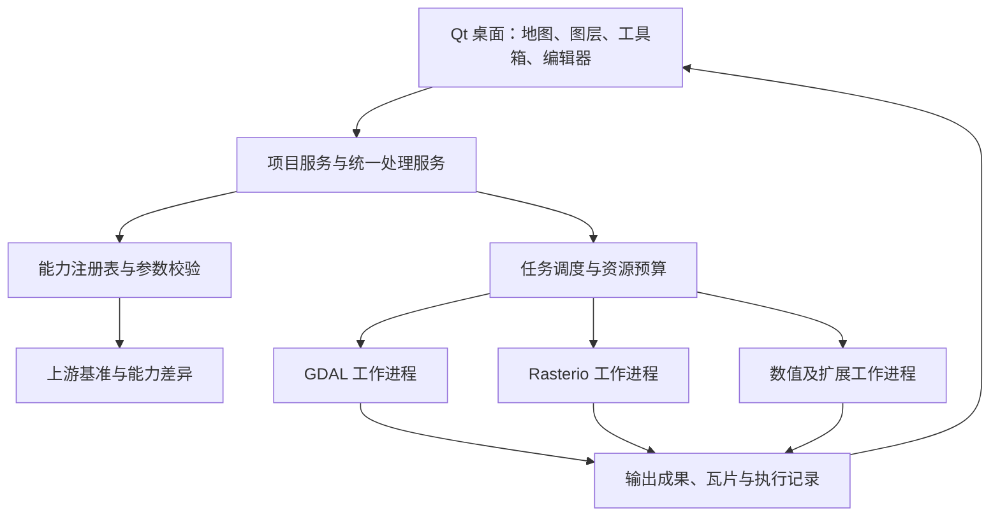

# 遥感与 GIS 工作台：完整开发方案

## 1. 目标与范围

暂用工程名 `Spectra Workbench`，Python 包名 `spectra_workbench`。名称可随后调整，中文界面先行。

开发 Windows x64 本地桌面软件，统一影像查看、栅格和矢量处理、坐标操作、科学计算、批处理与流程复现。用户要求 GDAL、Rasterio 等库包含的能力能够使用；课程实验不构成产品功能上限。

### 1.1 “全能力”的验收定义

- 以明确的上游版本和公开接口为边界，建立基准清单；GDAL 命令、公开算法、GDAL/OGR/OSR Python API、Rasterio 公开 API/rio 命令、驱动分开登记。
- 算法和数据处理命令优先提供可执行的图形参数面板；复杂对象 API 通过可用的 Python 会话和对象使用示例接入。
- 函数、类、方法、属性、枚举和配置不是同一类能力，分别建立索引，不能把符号总数当作算法总数。
- 官方能力在本机缺少驱动或依赖时仍留在基准清单中，清楚说明缺口；补齐依赖之后重新探测和验证。
- 分开统计基准登记率、可调用率、图形面板覆盖率、验收样例覆盖率、格式/驱动覆盖。不得把“有 Python 编辑器”说成所有 API 均逐项测试通过。
- 不受脚本入口限制常规使用体验：适合参数化的公开处理算法不能长期只有“自行写代码”入口。缺少结构化描述的传统工具采用人工参数描述补齐。
- C/C++ 专有且 Python/命令均未公开的功能单列原生扩展适配目标，登记缺口，不能静默从分母移除。

### 1.2 本次明确要求的引擎与扩展层次

| 层次 | 范围 | 交付要求 |
|---|---|---|
| 核心 | GDAL/OGR/OSR、Rasterio/rio、NumPy、SciPy | 有执行环境、统一任务、能力清单、真实样例 |
| 空间分析 | Shapely、PyProj；GeoPandas 作为表格/批量矢量可选插件 | 与对应 worker 的原生依赖相容，不强制装进 GUI 进程 |
| 遥感专题 | FFT、PCA、光谱指数、FVC、配准、基础分类、明确命名的融合/校正方法 | 独立算法定义、元数据契约和数值验收 |
| 扩展 | Xarray/Rioxarray/Dask、scikit-learn、PDAL、外部校正引擎、其他 GIS 引擎 | 插件接口先落实；各扩展的具体实现按登记任务推进 |

“等”通过插件扩展机制承接。首个正式版需要完成核心承诺和已列出的专题闭环；不声称一次实现整个科学计算生态或完整复刻 ENVI。

### 1.3 平台边界

先交付 Windows 11 x64；保持业务和任务协议跨平台。macOS/Linux 安装包列为后续发布目标。先做本地项目、二维栅格/矢量、多维数据切片；三维地球、协同服务器、GPU 全量加速、商业插件市场等登记为扩展，不阻塞核心平台。

## 2. 技术决策

| 部分 | 决策 | 实施说明 |
|---|---|---|
| 主语言 | Python | UI、注册表、任务、脚本和流程；避免在 Python 逐像元循环 |
| 桌面界面 | PySide6 / Qt 6 / Qt Widgets | QMainWindow、Dock、Model/View、快捷键和原生文件选择 |
| 影像画布 | 自定义 Qt 画布，初始可用 QGraphicsView | 瓦片、按需重投影、概览和缓存；后续可替换渲染实现 |
| 曲线 | PyQtGraph | 光谱、直方图、剖面；Matplotlib 作为高质量导出插件 |
| 地理引擎 | GDAL/OGR/OSR worker + Rasterio worker | 分进程；分别锁版本和记录驱动 |
| 数值 | NumPy / SciPy | FFT、矩阵、滤波、统计；性能瓶颈经测量后再考虑 C++ |
| 模型校验 | Pydantic 2 + JSON Schema | 任务和能力的领域模型；协议版本显式声明 |
| 项目与日志 | JSON 项目文件 + SQLite 历史库 | 项目是可移植配置；运行历史可重建、可迁移 |
| 插件发现 | Python entry points + 插件 manifest | UI 不直接 import 原生处理插件 |
| 后台与 IPC | QProcess + UTF-8 JSONL | GUI 异步收发，worker 独立进程 |
| 开发检查 | pytest、pytest-qt、Ruff；核心协议/领域模型类型检查 | 以数值、I/O、跨进程、恢复和 UI 流程为重点 |
| 环境 | conda-forge 解析原生依赖，项目独立环境 | 不修改用户系统 Python 或现有 GIS 环境 |
| 发布 | UI 的 PyInstaller onedir + 独立 engine runtime | 先验证重定位和依赖数据，再制作完整安装包 |

版本以 P0 的解析结果和官方接口核对为准。候选兼容范围：Python 3.12，PySide6 6.x，GDAL 3.11+ 且 <4，Rasterio 1.4+ 且 <2。该范围是起始约束，不是已验证的锁文件。若候选无法解析，可以在 Python 3.12/3.13 等受支持组合中调整，写 ADR 并完成同样验收。最终提交精确版本和构建信息，不能仅保存 `latest` 或未锁定的依赖范围。

## 3. 仓库与环境

```text
spectra-workbench/
  pyproject.toml
  README.md
  environments/
    ui.yml
    gdal.yml
    rasterio.yml
    science.yml
    locks/                         # P0 生成的 win-64 精确依赖
  scripts/
    bootstrap.ps1
    doctor.ps1
    run-dev.ps1
    test.ps1
    build.ps1
    audit-capabilities.ps1
  src/spectra_workbench/
    app/                           # 入口、设置、生命周期
    domain/                        # 能力、任务、数据集、图层、项目模型
    protocol/                      # JSONL、消息校验、数据传输描述
    registry/                      # 基准、发现结果、版本差异、状态
    scheduler/                     # 队列、进程、取消、恢复、资源预算
    providers/                     # 引擎适配协议；不在 GUI 顶层 import 原生引擎
      gdal_provider/
      rasterio_provider/
      science_provider/
    workers/                       # 命令入口、分派、日志、心跳
    data/                          # 元数据与数据引用，不持有跨进程原生句柄
    rendering/                     # 可见瓦片、缓存、显示变换、重投影请求
    processing/                    # 通用参数、表达式、流程执行
    project/                       # 文件格式、保存、迁移、恢复
    ui/
      main_window.py
      canvas/
      panels/
      forms/
      dialogs/
      models/
    scripting/                     # 引擎会话、编辑器、成果注册
    plugins/                       # manifest、版本协商、发现、启停
    resources/                     # 图标、翻译、主题，不放遥感原始数据
  capabilities/
    baselines/                     # 上游版本快照和来源
    overlays/                      # 中文语义、约束、传统工具参数补充
    recipes/                       # 用户和课程流程
  contracts/                       # 从本包复制并随实现维护
  tests/
    unit/
    integration/
    gui/
    fixtures/                      # 小型合成数据及生成脚本
    benchmarks/
  docs/
    plan/
    adr/
    progress/
    user/
  packaging/
    spectra.spec
    runtime-manifest.json
    installer/
```

### 3.1 环境隔离原则

- GUI 环境仅包含 Qt、图表、协议与必要的轻量依赖；GDAL/Rasterio 不导入 GUI 进程。
- GDAL、Rasterio、science 各用独立 worker。初期优先独立解释器环境，降低 DLL 与全局状态耦合；后续只有在验证充分时才合并环境，进程隔离仍保留。
- GeoPandas/Fiona 等也可能带原生地理依赖，加入相容 worker 环境，不能因为它们不是 `osgeo` 名称就随意导入 GUI。
- Windows 使用明确的可执行文件路径和单进程环境变量。按实际 runtime 设置 PATH、GDAL_DATA、PROJ_DATA 等，不全局更改系统 PATH。
- 运行时报告同时记录包版本、链接 GDAL/PROJ 等版本、驱动和引擎可执行文件路径；同名包不能替代实际探测。
- `scripts/bootstrap.ps1` 在项目指定目录创建环境；已存在的用户环境只读检查。
- `doctor` 对每个引擎分别做导入、GTiff 小文件往返、重投影、CLI 和数据目录检查；单个可选驱动缺失不能导致整个 GUI 无法启动。
- 将同一项目 wheel 安装到各 worker 环境时不重新解析整套 GUI 依赖；worker 入口只加载协议与对应 provider，不能经包顶层导入 PySide6 或其他引擎。用独立依赖组和惰性导入落实此边界，并记录 worker 包哈希。
- 从冻结的 GUI 启动 worker 时，按白名单构建子进程环境，检查继承的 Qt 插件路径、DLL 搜索路径和冻结程序变量；不得把 UI 打包目录强行当成地理引擎库目录。

## 4. 总体架构与边界



### 4.1 模块职责

- **domain**：无 Qt 和原生地理依赖；描述输入输出、空间网格、NoData、版本和状态。
- **registry**：合并“应该有哪些”与“当前有哪些”，提供工具目录、依赖状态和版本变化。
- **providers**：在对应 worker 内把标准任务转换成 GDAL、rio、Rasterio 或科学算法调用。
- **scheduler**：决定何时何处运行；不实现算法本身。
- **rendering**：只调度可见窗口，管理版本和缓存；不把显示数组当作科学计算输入。
- **UI**：显示数据、修改模型、提交任务和处理事件；不执行大文件计算。
- **project**：持久化图层、样式、流程和数据引用；不保存活的 C/C++ 句柄。

### 4.2 Provider 协议

在对应 worker 内实现统一协议，函数名可以调整但职责需一致：

```python
class ProviderAdapter(Protocol):
    def runtime_info(self) -> RuntimeInfo: ...
    def discover(self) -> list[CapabilityDescriptor]: ...
    def validate(self, spec: TaskSpec) -> ValidationReport: ...
    def estimate(self, spec: TaskSpec) -> ResourceEstimate: ...
    def execute(self, spec: TaskSpec, context: ExecutionContext) -> TaskResult: ...
```

`ExecutionContext` 包含进度、取消令牌、日志、任务工作区、成果登记、只向当前进程应用的配置。处理适配器也可执行元数据、读瓦片或坐标查询；这些交互请求与批处理作业使用不同队列优先级。

## 5. 数据、任务与协议契约

### 5.1 核心领域模型

| 模型 | 必需语义 |
|---|---|
| DatasetRef | 稳定 ID、URI、数据类型、子数据集/数组选择、源指纹、认证配置引用 |
| RasterMetadata | 尺寸、波段、dtype、空间模型、CRS、NoData、mask、scale/offset、单位、波长、驱动、概览 |
| VectorMetadata | 图层、字段、几何类型、CRS、范围、能力；巨大要素数允许未知或估计 |
| GridSpec | 宽高、完整 affine 或其他地理定位模型、CRS、分辨率、像元对齐约定 |
| LayerState | 数据引用、样式、可见性、透明度、波段映射、显示范围、版本 |
| CapabilityDescriptor | 身份、版本、参数、输入输出、依赖、入口和独立状态维度 |
| TaskSpec | 协议版本、能力与描述哈希、输入、参数、输出计划、资源、重试策略、来源 |
| TaskResult | 终态、输出及数据类型、验证结果、耗时、警告、错误、引擎版本 |

数据集可无 affine，例如仅 GCP、RPC、地理定位数组或未配准像素影像；模型不能强制每个数据源都有 north-up affine。第一个版本可对部分空间模型只提供原始像素视图并标注状态，之后按任务接入校正。

### 5.2 JSONL 消息

每行一个 UTF-8 JSON 对象，以换行结束。每条消息有 `protocol_version`、`kind`、`message_id`、`request_id`、`task_id`（如适用）和 `payload`。不在同一 stdout 写入普通日志或第三方 print；用户脚本的 stdout 捕获并转换为日志事件。stderr 单独收集。

消息种类至少包括：`hello`、`ready`、`request`、`accepted`、`progress`、`log`、`artifact`、`result`、`error`、`cancel`、`heartbeat`。

- 客户端收到部分字节先缓存，不能把一次 readyRead 当成完整 JSON；支持连续多行、UTF-8 跨包和超长日志分段。
- 单条控制消息建议上限 1 MiB，超出转文件引用；限制是协议设计值，双方一致。
- 请求有超时、请求 ID、worker 代号和世代号。worker 重启后的旧响应不得应用到新任务。
- 大数组与瓦片先通过任务目录文件及 dtype/shape 描述传输；稳定后再引入共享内存并实现引用计数与异常回收。
- 图像可用 RGBA 二进制缓存或 PNG；QPixmap 仅在 GUI 线程创建，QImage 的底层缓冲必须在使用期间存活或显式复制。
- 原生 Dataset、Band、Layer、Geometry 等句柄不跨进程传输。需要链式对象操作的脚本留在对应会话进程中执行。

### 5.3 任务状态与取消

状态：`queued → validating → running → succeeded/failed/cancelled/interrupted`；`running` 可进入 `cancelling`。失败与取消必须终结一次任务尝试；重试新建 attempt，保留原记录。

后台同步计算不能阻塞取消监听。worker 用专门的消息监听线程/控制通道设置取消令牌；算法回调或分块边界读取令牌。若引擎无法协作取消，超过宽限时间结束专用作业进程；Windows 子进程链需要实际验证清理策略，可使用 Job Object 或明确的子进程追踪。不得误杀其他 Python/GIS 进程。

长作业每个进程最多执行一个活动任务。渲染/像元查询使用独立低延迟 worker 池，不能排在数小时作业后面。初始并行长作业数 1，可由资源预算扩展；避免多进程乘以内部线程数导致过量并发。

### 5.4 输出提交与恢复

- 输出先写入任务专有 staging 目录，成功关闭、刷新并重新打开检查后才登记为成功成果。
- 单文件同卷可使用替换提交；Shapefile、ENVI 及目录型成果使用文件清单和可恢复提交事务，不能假设一次 rename 原子覆盖所有 sidecar。
- 原位更新、已有数据库追加和远程对象写入另有副作用策略；不能声称所有引擎操作均可撤销。普通工具默认创建新输出。
- 用户主动选定覆盖目标时只针对具体目标处理冲突，避免每次提交普通任务都重复询问。
- 取消、崩溃、断电后由 manifest 区分临时、已提交、部分提交成果；保留恢复说明，不把残缺文件自动加载为成功图层。
- 项目路径重定位支持重新关联；任务恢复不自动重复执行可能写入外部数据库的操作。

## 6. 全量能力注册与参数界面

### 6.1 基准、发现和叠加

每个引擎版本保存一份基准，来源包括官方公开文档、引擎结构化描述、版本化清单。运行时扫描只能说明当前环境，不能作为唯一分母。记录来源 URL、抓取或生成日期、版本/构建、内容哈希和已知限制。

GDAL 新统一 CLI 通过 `--json-usage`、Algorithm 参数描述获取结构化信息；针对实际 JSON 结构编写解析器，并保存小型脱敏 fixture。不同版本由适配器处理，不硬编码网上某个未来版本的参数。

传统 GDAL/OGR 工具按目标版本官方目录核对。具备 Python utility 入口的优先直接调用；其余通过明确的可执行文件和参数数组启动。命令别名与新旧实现建立关系，避免覆盖统计重复计算。

Rasterio 采用官方公开模块/API 基准 + 对应 worker 的签名与文档核对 + 实际 rio 命令与插件枚举。不能对所有属性盲目 `getattr`、实例化或递归 import 私有模块；原生方法无法反射签名时标注限制，用人工描述补充。

### 6.2 入口和状态分开

使用 `kind` 区分 algorithm/cli/function/class/method/property/enum/config/driver。状态至少分为：

- presence：present/missing/unknown；
- binding：none/indexed/script/cli/form/specialized；
- validation：not_run/smoke_passed/numerical_passed/failed/not_applicable；
- availability：ready/missing_dependency/unsupported/blocked；
- limitations：结构化说明具体限制与下一步。

同一项可以已有表单但缺少驱动，不能用一个布尔值 `supported=true` 混淆。

### 6.3 自动表单规则

参数类型：输入/输出数据集、文件、目录、URI、波段、多波段、CRS、范围、像元尺寸、整数、浮点、布尔、枚举、字符串、列表、键值选项、表达式、SQL、JSON、结构化对象、回调/脚本引用。

表单支持必填、缺省/显式空值、取值范围、重复参数、相互依赖、互斥、条件可见、多输出和 format-specific options。默认值保留上游原值，中文说明通过 overlay 叠加。未知参数保留受校验的高级入口；不能默默丢弃后提交。

提交前显示最终引擎、版本、输出及重要参数；有参数化命令/脚本预览和复制入口。执行使用参数数组，禁用 shell 字符串拼接。中文路径、空格、引号和以连字符开头的文件名纳入测试。

普通影像表达式通过受限 AST/运算函数白名单解析，检查数组尺寸和除零；高级 Python 编辑器执行用户自己的代码，明确标注为本机代码执行环境，不称为安全沙箱。

## 7. 界面与交互

### 7.1 主窗口

```text
┌ 菜单：文件 编辑 视图 数据 栅格 矢量 遥感 分析 工作流 脚本 帮助 ┐
├ 常用操作、导航、ROI、像元查询、卷帘、撤销/重做                 ┤
│ 图层/数据源     │  单视图/分屏地图画布         │ 可搜索工具箱     │
│ 项目树          │  灰度/RGB/伪彩              │ 参数与高级选项   │
│ 波段/元数据     │  比例尺、坐标、选区          │ 样式/直方图      │
├ 任务队列 | 日志 | 统计表 | 光谱 | Python 编辑器                ┤
└ 状态栏：CRS、坐标、行列、原值、显示比例、后台任务              ┘
```

中文名称与英文原始算法名并存。原生控件、清晰字号、可停靠面板和键盘操作优先。避免把实现类名、内部 JSON 或堆栈当成用户正常操作入口；技术诊断放到详情页。主题支持系统明暗、Windows 高 DPI 与多屏。

### 7.2 必需交互

- 拖放文件、最近项目、选择子数据集、明确显示缺失源。
- 图层顺序、分组、可见性、透明度、样式复制、关闭释放句柄。
- 灰度/RGB/伪彩，波段选择与波长辅助；scale/offset 与原始值显示模式明确区分。
- 线性/百分位/标准差等拉伸按当前选定模式计算；抽样或可见范围统计标注来源。
- 单视图、双视图、四视图，按地图坐标同步或按像元同步，模式明确。
- 卷帘、闪烁、光谱和剖面；栅格差值必须在确定的共同网格上计算。
- 矩形、多边形 ROI，导入导出，修改、撤销/重做；几何合法性与坐标系校验。
- 任务进度、取消、重新运行、参数重开、结果定位、日志详情。

## 8. 大影像与渲染

- 使用可见范围计算瓦片请求，初始 tile_size=512，读取选择合适概览并限制输出像素；不在打开文件时读入整幅所有波段。
- 读取窗口与底层块布局配合；小窗口也可能触发整个存储块的 I/O，性能测试区分 tiled/striped、压缩、无概览和远程数据。
- 每个视图有 view_crs、view_grid、缩放和 generation ID。不同 CRS 图层由 worker 重投影到同一显示网格，不能仅把各自像素位置叠加。
- 无 CRS 影像使用显式像素视图；用户指定 CRS 是赋值操作，真正重投影是另一操作。
- 缓存键至少包含源指纹、子数据集/切片、波段、目标网格、窗口/分辨率、重采样、掩膜和样式版本。区分原始窗口缓存与 RGBA 显示缓存。
- 拖动或切换波段后抛弃过期请求，按视图中心优先；限制排队，缓存采用有容量上限的 LRU。
- 默认缓存预算按可用内存计算并设上限，例如初始建议 RAM 的 10%、最多 512 MiB；P0 后根据实际资源调整，不能硬占固定数 GB。
- 原始像元值、应用 scale/offset 的物理值、显示拉伸值分开。NoData、alpha、mask 和合法零值保持区别。
- 栅格空间变换使用完整 affine 及逆变换，测试旋转/错切和负像元高；GCP/RPC/geolocation 数据按其实际模型处理。
- 地理经纬度显示和坐标运算固定并记录轴顺序约定；跨日界线和极区用专门样例，未支持的显示情形准确提示。
- 原始文件上的概览/统计写入有明确操作；单纯查看优先使用应用缓存，不静默改写用户数据。

## 9. 栅格、矢量、多维与远程功能

### 9.1 栅格

读取/检查、转换、裁剪、重投影、重采样、拼接、VRT、波段堆叠、类型转换、scale/offset、元数据、NoData/掩膜、概览、栅格计算器、填洞、栅矢转换、等值线、邻域/地形/视域及目标版本提供的其他算法。按能力基准补齐入口，不以此段例举清单作为全部上游功能。

### 9.2 矢量与坐标

数据源/图层选择、属性表分页、字段和空间过滤、格式转换、重投影、SQL、缓冲、叠加、几何检查/修复、栅格化等。大型图层按范围查询和空间索引，不一次性加载所有要素；显示简化与真实分析几何分开。地理坐标下的距离/面积必须有明确测量方法与单位。

### 9.3 多维数据

显示 group、array、dimension、attribute；选择 time/depth/band 等维度，形成明确二维切片并导出；不把每个 NetCDF/HDF 数组都假定为普通 RGB 影像。维度坐标、单位、scale/offset、NoData 和 CRS 保留。无法定位的数组可用矩阵视图，不能编造地理参考。

### 9.4 远程与 VSI

支持目标驱动的 HTTP/S3/归档/VSI 数据路径和配置，远程连接有超时、取消、重试与范围读取能力检测。初始使用本地 HTTP 测试服务验收，不要求真实云账号。认证配置仅保存引用，密钥保存在操作系统凭据存储或用户外部配置；日志和导出的流程清除敏感 query/token。离线启动和本地处理不依赖联网。

## 10. 遥感专题算法与课程映射

### 10.1 第一组可独立验证算法

- **NDVI 等指数**：按元数据/用户明确选择 Red、NIR 等波段；计算前转换浮点类型；处理 mask、scale/offset、分母零。不能将某一传感器编号推广到全部数据。
- **FFT**：二维变换、中心化频谱、对数幅度、掩膜编辑、反变换；实值图像提供共轭对称约束；奇偶尺寸、复数类型、虚部误差和 NoData 策略可核对。
- **PCA**：输出均值、协方差/相关矩阵选择、变换矩阵、特征值、成分顺序和重建参数；完整成分重建误差验收；大数据统计可分块但不能未经定义就对每块独立 PCA 冒充全图结果。
- **FVC**：二分像元模型可作为独立方法；课程流程还要支持分类掩膜、各类 2%/98% 分位端元和逐像元端元图。分位算法、有效样本与分级边界可保存；越界保留质量标记，裁剪/屏蔽是明确选项。
- **GCP 配准**：基础仿射/多项式或目标引擎支持的变换、控制点保存、残差、独立检查点误差、重采样。拟合残差和独立验证误差分别显示。
- **分类**：基础监督分类插件、训练 ROI、标签、空间上独立的训练/验证划分、混淆矩阵；首个可选实现采用 scikit-learn 的明确算法，不能称为 ENVI 所有分类器等价实现。

### 10.2 后续专题

缨帽系数按传感器与产品级别登记；Brovey、HSV 等融合分别定义输入网格、波段、公式和适用范围；NNDiffuse 等只有方法和依赖落实后才标可执行。

Landsat 等辐射定标解析真实元数据、单位、增益偏移及太阳几何；热红外亮温等属于不同输出，不能混称反射率。FLAASH 列为外部引擎适配/特定方法验证目标；使用其他大气校正方法时明确名称、参数和差异。不能以一个简化公式宣称完成 FLAASH。

课程去云为云/云影区域识别、缓冲、多时相替换与镶嵌，输出保留像元来源时间和掩膜。云下信息来自其他时相，不能描述为恢复原时刻真实地表。农业计数保留直径、尺度、阈值、重叠参数及人工标注对照，方法确定前状态为待实现。

### 10.3 课程资料清单

| 课程 | 平台能力与专题 |
|---|---|
| 精准农业 | ROI、计数、参数预览与统计 |
| 频率域图像处理 / FFT | 频谱、滤波器、逆变换、去条纹 |
| 定标和辐射校正 | 元数据、定标、外部/独立校正方法 |
| 去云 | 分类、掩膜、缓冲、多时相替换与镶嵌 |
| 高光谱辐射校正 | 波长、坏波段、光谱、校正引擎 |
| 编辑头文件 | 名称、波长、FWHM、坏波段及数据契约 |
| 国产卫星小测试 | 传感器适配、系数、前后光谱 |
| 配准和融合 / 几何校正 / 图像配准 | GCP、重采样、几何定位、融合和差值 |
| 图像变换 | 指数、缨帽、PCA、锐化、波段堆叠 |
| 植被覆盖度 | 分类掩膜、分位数、端元图、FVC、统计 |

课程步骤图中的姓名学号、发班群和扩展安装等属于教学材料内容；开发时提取功能需求，不自动执行其对外操作。

## 11. 批处理、工作流与脚本

工作流为带版本的 DAG，节点引用稳定 capability_id、引擎约束、参数和类型化端口；提交前做环检测、参数与端口检查、路径冲突和资源估算。

不假定任意两个工具都能连接。明确 Raster/Vector/Table/Array/Scalar/Artifact 等端口类型，跨进程对象节点默认物化文件；同一进程内管线优化后续实施。缓存引用输入指纹、完整参数、引擎与能力描述哈希及关键配置，外部数据库/远程输入仅在来源稳定且有标识时缓存。

节点失败时停止依赖节点，独立节点按策略继续；支持从已验证成功的物化成果恢复。大文件默认不全文件哈希，记录 size/mtime 等快速指纹及强校验选项，明确复现等级。

Python 编辑器为 GDAL、Rasterio、science 分别选择会话，支持执行、停止、变量文本摘要、日志、保存脚本和 `context.register_artifact()`。编辑器直接保留公开 API，不限制用户只用平台包装函数。会话中的对象引用有生命周期；会话退出后只保存可序列化配置和已物化成果。

## 12. 项目、日志和插件

项目文件扩展名暂定 `.spectra.json`，内容有 schema_version、项目 ID、相对/绝对数据引用、图层与样式、视图、ROI/控制点引用、流程、认证 profile ID。项目保存使用临时文件和替换，迁移前保留旧版本。用户脚本和敏感字段不自动嵌入导出诊断包。

P3 先实现最小项目保存/重开，至少保存源引用、图层样式、视图与布局，供 P4 的完整用户流程验收。P7 在此基础上补全迁移、重定位、自动恢复、ROI/控制点及工作流，不把基础保存能力推迟到 P7。

SQLite 存储 task、attempt、artifact、engine_runtime、capability_validation 和 schema migrations；不把 SQLite 文件作为多个 worker 随意共同写入的日志目标。由应用服务集中写入或采用清晰的写入队列。

插件 manifest 描述 ID、版本、provider_api_version、worker 解释器/依赖、能力列表、UI 扩展入口和文档。用 entry points 发现，不在 GUI 扫描期间导入原生计算模块。插件崩溃隔离到 worker；连续启动失败后禁用并提供恢复入口。用一个真实的小型统计插件验证安装、发现、执行、禁用和版本不兼容提示。

## 13. 测试策略

具体样例见 `02_里程碑与验收.md`。重点是：

- 已知解析结果的合成影像验证算法；用独立公式/数学不变量而非把实现输出当参考值。
- 引擎原生命令与 UI 路线在相同参数下比较，检查空间参考、NoData、mask、dtype 与像元值；不同引擎默认值先显式对齐，不能盲目要求逐位相同。
- GUI 测试验证真实选择输入、设置参数、提交任务、打开结果，后台不可用时准确显示。
- 跨进程、取消、日志编码、崩溃、项目恢复、多文件输出提交与环境重定位是必须测试的高风险路径。
- 大文件和网络测试与小型确定性测试分层，不能每次测试生成数十 GB；磁盘不足时说明跳过原因，不能假装通过。
- `pytest`、Ruff 和核心类型检查完成后保留结果摘要；性能与发布验收另存报告，不能用截图代替计算验证。

## 14. 发布和维护

开发版可由一键脚本启动；正式 Windows 包使用 UI onedir + 隔离 engine runtime。引擎环境使用经过测试的打包/重定位方式；conda 环境不能直接拷贝后假定任意路径可运行。PyInstaller 的动态插件、Qt 插件、资源文件及原生依赖需显式检查。

在无开发环境的 Windows 测试机验证：中文/空格路径、离线、本地输入、所有 worker 启动、必要驱动、CRS 数据目录、脚本和导出。安装包不得依赖本机全局 Python、开发目录或网络下载。用户数据和安装目录分离，卸载默认保留用户项目。

每次升级保存引擎和依赖清单、能力差异、项目迁移记录、已知限制及验收结果。提供本地诊断导出，默认移除凭据和不必要的个人路径。第三方组件的发行条件与声明在打包阶段逐项核对并保留，本文不替具体发行作法律结论。

## 15. 执行顺序与交付标准

严格按 `02_里程碑与验收.md` 的 P0–P10 推进，每阶段交付可运行的增量和证据。可以跨阶段准备不依赖的文档/小型数据，但不能跳过引擎隔离、任务闭环、显示坐标契约和版本记录。

Qoder 每轮应实现当前最早未完成且依赖满足的任务，运行适当验证，更新任务状态和进度；不需要用户逐项重新批准普通实现选择。网络不可用、缺少真实课程数据等只阻塞相关验收，继续可推进内容。不得靠大量 TODO、假按钮、静态图层和伪造进度宣称功能已完成。
